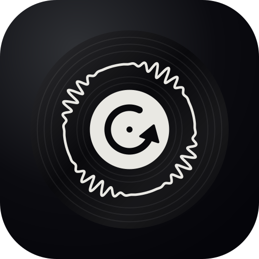
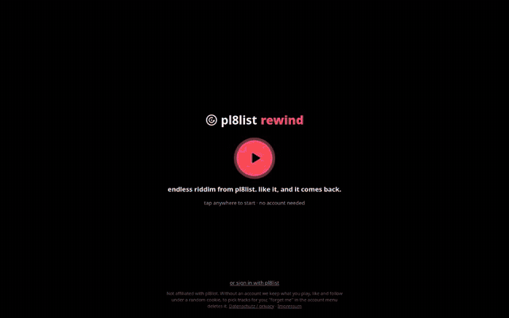

<p align="center">
  
</p>

<h1 align="center">pl8list rewind</h1>

<p align="center">
  <b>Endless riddim from pl8list. Like it, and it comes back.</b>
</p>

<p align="center">
  <a href="https://pl8.narl.io"></a>
</p>

<p align="center">
  
</p>

An endless, TikTok-style scroll through [pl8list](https://pl8list.com), with its own
recommendation algorithm that learns from what you like, finish and skip. Open
[pl8.narl.io](https://pl8.narl.io) and press play: no account needed. Sign in with your
pl8list account to bring your likes and follows along.

The name is the soundsystem rewind: when a dance loves a tune, the selector pulls the
plate back and runs it again. Here, what you like comes back.

Not affiliated with pl8list.

## Features

- **One track per screen.** Swipe, scroll or press ↓. The next track is already buffered and
  crossfades in.
- **Discovery.** A personalized feed, new tracks, deep cuts, and pl8list's best-seller
  and free-download charts for this week, this year, or all time.
- **Artist radio.** Start a radio from any artist: them and their neighbours in the artist
  graph, with a reason on each track.
- **Liquid artwork.** A WebGL drop that moves with the kicks, snares and wobble of the track.
  On riddim it turns to ferrofluid.
- **Drop marks and timed comments.** The waveform marks the drops (`d` jumps to the next
  one). pl8list comments pop up at the moment they were left at.
- **Comfort.** Likes and history panels, sleep timer, bass boost, crossfade length, zen
  mode, lock-screen and headphone controls. Installs to the home screen as an app.
- **Private by design.** The browser only talks to this server. Audio and images are
  proxied, so no visitor address reaches pl8list or a CDN.

## Screenshots


<p align="center">
  
  
</p>

| Likes | Filters and settings |
| ----- | -------------------- |
|  |  |

## Run it yourself

```sh
docker compose up -d --build       # http://127.0.0.1:8790
```

or without Docker (Rust 1.85+, Node 22+):

```sh
cd web && npm ci && npm run build   # front end into web/dist
cd ../backend && cargo run --release # embeds web/dist at build time
cargo test                          # unit tests + API tests against a fake pl8list
```

For front-end work run the server, then `npm run dev` in `web/`: Vite serves the page with
hot reload on http://127.0.0.1:5173/static/ and passes API calls to the server (`BACKEND=` to point it
elsewhere). Debug builds of the server read `web/dist` from disk, so `npm run build` is enough
to see changes on :8790 too.

The server is the Rust crate in `backend/`, the front end is TypeScript in `web/` (Vite, no
framework). The old Python server is gone from the tree; it is in the history at `54a436a`,
and still opens the same database.

Before going public in Germany, set the Impressum variables below. `/impressum` and
`/datenschutz` are filled in from them at startup; the texts are in `backend/templates/`.
Have them checked: they are a careful draft, not legal advice.

`compose.override.yaml` puts it behind Traefik at `pl8.narl.io` on the external `narl`
network, the same way as the other narl.io services. Docker Compose picks it up
automatically. Delete it, or change the host name, to run somewhere else.

Data (catalogue, users, listening history) lives in the `data` volume as one SQLite file.

| variable      | default            | meaning                                           |
| ------------- | ------------------ | ------------------------------------------------- |
| `HOST`        | `127.0.0.1`        | bind address (`0.0.0.0` in the image)             |
| `PORT`        | `8790`             | port                                              |
| `PL8_DB`      | `./pl8list.db`     | SQLite path (`/data/pl8list.db` in the image)     |
| `TRUSTED_PROXY_HOPS` | `0`         | reverse proxies in front that append to `X-Forwarded-For` (`TRUST_PROXY=1` also means 1) |
| `PUBLIC_ORIGIN` | unset            | `https://host` of the site; POSTs with any other `Origin` are refused |
| `CACHE_DIR`   | `cache` next to DB | disk cache for audio segments and artist images   |
| `CACHE_MAX_MB` | `2048`            | cache size limit, least recently used files go first |
| `LINK_KEY`    | unset              | server half of the key for stored pl8list sessions (base64, 32 bytes) |
| `LINK_KEY_FILE` | `link.key` next to DB | used when `LINK_KEY` is unset; created on first start |
| `INSECURE_COOKIES` | `0`           | `1` only for plain-http development from another machine |
| `IMPRESSUM_NAME`, `IMPRESSUM_ADDRESS`, `IMPRESSUM_EMAIL`, `IMPRESSUM_PHONE` | empty | operator details for `/impressum` and `/datenschutz`; separate address lines with `\|` |
| `HOSTING_PROVIDER` | empty         | hosting company and address, named in the privacy policy |

## Accounts

Nobody needs an account to listen. Pressing play the first time makes a guest
(`POST /auth/guest`, at most 10 per IP per hour): a local user with its own session cookie,
so the feed still learns. When a guest signs in on that device, their likes, follows and
history move to the signed-in account. Signing out as a guest deletes the guest and its data.

There are no passwords here. Users sign in with the email of their pl8list account:

1. The user enters their email. The server starts pl8list's own login, and pl8list mails
   them a 6-digit code.
2. The user types the code. The server passes it to pl8list. If pl8list accepts it, the
   server reads the user's pl8list id and handle, creates a local account, and sets its
   own session cookie (`__Host-pl8inf`, Secure, HttpOnly, SameSite=Lax). It ends after 30 days
   without use and gets a new token every 7 days.

By default the pl8list session from step 2 is used once, in memory, to sync with the user's
pl8list account: their personal feed, their saved tracks (they become likes here) and their
saved artists (they become follows). It is never written to disk, and when the sync is done
(or fails) the server logs that session out at pl8list. Only a SHA-256 hash of the local
session token is stored.

**Stay connected** is an opt-in checkbox at sign-in, per device. Then the pl8list session is
stored in that device's `sessions` row, encrypted with XChaCha20-Poly1305 under a key derived
(HKDF-SHA256) from the device's local session token and a server key (`LINK_KEY`). The
token only exists in the browser cookie, so a copy of the database, even with the server key,
opens nothing; the server can only decrypt during that device's own requests. With it, the
app resyncs on use every 6 hours and on the "resync with pl8list" button, and saves new
likes and follows to the user's pl8list library (`add-to-library?addOnly=true`, so it never
removes anything). If pl8list sends a new cookie it is stored again; if pl8list redirects to
its login, the stored session is deleted. Weekly token rotation re-encrypts it for the new
token. "stop staying connected", sign out and account deletion log it out at pl8list and
delete it. pl8list's `_session` is a signed cookie, so their logout may not invalidate a copy;
treat a stored session as long-lived.

Without stay connected, "resync with pl8list" in the account menu runs the email-code sign-in
again and syncs once.

Every login start and resend makes pl8list send a mail, so they are rate-limited: 5 per IP
and 3 per email per 15 minutes, 30 per 10 minutes for the whole server, at most 2 resends
and 5 code attempts per login, and at most 500 logins pending at once. Behind a proxy
(`TRUSTED_PROXY_HOPS=1`) the client IP is the last `X-Forwarded-For` entry, the one the proxy
added; IPv6 addresses are limited per /64.

The "account" menu shows the pl8list sync state and lets users resync, stop staying connected,
download everything stored about them (JSON), sign out on all devices, or delete their account
(likes, follows, history and sessions, right away). Expired sessions
are purged hourly and "served" events after 180 days. The browser only ever talks to this
server: hls.js is bundled into the front end and audio and images are proxied, so no
visitor address reaches pl8list or a CDN.

## Controls

| phone            | desktop                   | action                                |
| ---------------- | ------------------------- | ------------------------------------- |
| tap              | click · space             | play / pause                          |
| double-tap       | double-click · l          | like                                  |
| swipe up / down  | ↓ j · ↑ k · wheel         | next / previous                       |
| drag waveform    | drag waveform · ← →       | seek (keys: 10 s)                     |
|                  | , .                       | seek 5 s                              |
|                  | 0–9                       | jump to 0–90 %                        |
| drop ↓ button    | d                         | jump to the next drop                 |
| follow button    | f                         | follow the artist                     |
| radio button     | r                         | artist radio (more like them)         |
| share button     | s                         | share / copy link                     |
|                  | v                         | liquid / simple visuals               |
|                  | z                         | zen: just the drop                    |
|                  | c · h                     | filters and settings · history        |
|                  | m · + −                   | mute · volume                         |
|                  | ? · Esc                   | help · close panels                   |

Lock-screen, notification and headphone buttons control playback too (Media Session API).
The tabs in the top bar pick the feed (for you, charts, new, deep cuts). Charts keep
pl8list's ordering and include tracks you've heard before. Tempo presets include half and
double time; custom BPM ranges match the exact value. "likes" lists your
likes newest first, with search; "play" queues them in order or shuffled, and ▶ plays one
right away. "history" lists what played lately, kept on the device only. The filters panel
holds the filters and the settings: visuals, ferrofluid spikes, crossfade, bass boost,
comments on the waveform and the sleep timer. "radio" on a card opens the radio
sheet: the artist, their tags and the artists next to them (tap one to walk over to theirs).
"start radio" jumps to the radio's first track; each radio track says why it is there, and the
chip in the top bar goes back to your feed. Feed and filters (free only, BPM range) are
remembered per browser. The site can be installed to the home screen as an app.

Single-letter keys clash with vim-key browser extensions (Vimium and the like), which take
`r`, `x` and `f` before the page sees them; turn those off for the site.

## Front end

`web/src/`:

- `pager.ts`: the feed. One card fills the screen; drag, flick, wheel and keys turn the page,
  with a spring that follows the finger's speed and a rubber band at the ends. Only the
  current card and its neighbours are in the DOM. One wheel or trackpad gesture moves one
  page.
- `player.ts`: two audio decks. The next track is buffered a few seconds after the current
  one starts, so it plays at once; tracks crossfade (equal power, 0.9 s unless set otherwise
  in the filters panel) and the next one
  starts just before the current one ends. Both decks run through a Web Audio graph with an
  analyser. Not on iOS: its element volume is read-only and Web Audio stops with the screen
  locked, so there tracks switch with a cut and lock-screen playback keeps working.
- `features.ts`: what the music does, per frame: band levels against their recent range,
  kick and snare onsets (spectral flux over an adaptive threshold), wobble in the mids, and
  drops. A plain bass meter sits at full scale through a whole dubstep drop; these keep
  moving. Without the analyser only loudness from the track's waveform is left.
  `?debug=audio` shows them live, with onset counts.
- `blob/`: the liquid artwork. One WebGL2 canvas moves into the playing card: an icosphere
  displaced by noise driven by those features (lobes, ripples, snare spikes, a ring after each
  kick), showing the artwork through its surface. Tempo, tags and key set its character
  (`blob/style.ts`). Dragging it spins it; a flick keeps spinning and springs back to face
  the front (`blob/spin.ts`). It steps its quality down on slow devices and falls back to the
  plain artwork without WebGL2, with reduced motion, or with visuals set to simple.
- `visual.ts`: runs both per frame, plus `--energy` (kick-driven) for the CSS glow.
- `station.ts`: the radio sheet.
- `color.ts`: each card's accent colour (`--card-accent`) from the artist image.
- `cards.ts`, `api.ts`, `main.ts`: cards, server calls, and everything else.

Design tokens are CSS custom properties at the top of `style.css`. `prefers-reduced-motion`
turns off the spring, the pulse and the animations.

## How it works

pl8list has no public API, but it is a Remix app: every page loader returns JSON when you add
`?_data=<route id>`, and `/api/*` routes return JSON directly. Paginated loaders also need
`pagination=true`. All of this works without an account for public data:

| endpoint                                                             | gives                               |
| -------------------------------------------------------------------- | ----------------------------------- |
| `/?_data=routes/_index`                                              | best sellers, recommended, ticker   |
| `/api/feed?page=N&pagination=true`                                   | a user's feed (needs their session) |
| `/api/activity-ticker`                                               | artists with recent downloads/sales |
| `/best-selling-artists?_data=routes/best-selling-artists`            | top artists                         |
| `/search/users?q=…&page=N&pagination=true&_data=routes/search.users` | artist search (≥ 3 chars)           |
| `/<handle>?page=N&pagination=true&_data=routes/$handle`              | an artist's tracks, 10 per page     |
| `/<handle>/<slug>/related?_data=routes/$handle_.$slug.related`       | 3 related tracks                    |
| `/api/<handle>/<slug>/hls/playlist.m3u8?v=<uploadId>[&preview=true]` | HLS audio                           |
| `/login`, `/verify?email=…&mode=login`                               | email + 6-digit code login          |
| `/library/tracks?page=N&pagination=true&_data=routes/library.tracks` | saved tracks (needs session)        |
| `/library/artists?…&_data=routes/library.artists`                    | saved artists (needs session)       |
| `POST /api/<handle>[/<slug>]/add-to-library?addOnly=true`            | save artist or track (needs session) |

**Crawler** (`backend/src/crawler.rs`). There is no "all tracks" listing, so one shared catalogue grows by
snowballing: home sections, the ticker, best-selling artists and artist search give artists;
artist pages give tracks; related pages pull in neighbours. Artists are re-checked daily for
new uploads. Requests are throttled to about 1.4 per second while someone has used the app in
the last 30 minutes, or while the catalogue has fewer than 500 tracks. Otherwise it slows to
one request every 20 seconds. When a user likes or finishes a track, its related tracks and
its artist's catalogue are crawled first.

**Ranking** (`backend/src/ranker.rs`). Each track the user has not seen yet gets a score from popularity,
freshness, artist affinity (from their likes, completions, skips and follows), closeness to the BPM and
key of tracks they liked, whether it is related to something they liked, and some random
exploration. Artists are then spread out so you don't get five tracks from one person in a
row. Weights live in a `Ranker`, which can also narrow the candidates and add a bonus;
`?mode=` on `/local/feed` picks one:

| mode                       | what it plays                                                                  |
| -------------------------- | ------------------------------------------------------------------------------ |
| (none) / `classic`         | the mix above                                                                  |
| `riddim`                   | 140 BPM (or 70) tracks, riddim first                                           |
| `fresh`                    | uploads of the last 45 days, newest weighted up                                |
| `deep`                     | tracks with 15 saves or fewer; popularity counts against a track               |
| `artist&artist=<handle>`   | artist radio: the artist and their neighbours in the artist graph (two hops)   |

`/local/charts?kind=sales|free&period=week|year|all-time` returns the corresponding
public pl8list chart in its original order, independently of served-track history.

In an artist radio each track carries `why`: `seed`, `related` (a neighbour), or `via` with the
neighbour that leads to a second-hop artist. `/local/artist?handle=` returns an artist, their
top tags and closest neighbours for the radio sheet, and starts crawling the neighbourhood
(at most every 10 minutes per artist); `exploring` is true while there are fewer than three.

**Tags** (`backend/src/tags.rs`). pl8list has no genre field, so tags come from words in the
title, description and artist name, and from the BPM: styles (`riddim`, `tearout`, `wonk`, `dnb`,
…), versions (`vip`, `dub`, `dubpack`, `remix`, `flip`, `special`, `collab`, `wip` for v1/v2…)
and tempo (`140`, `170`). They are stored in `track_tags`, sent with each track and shown on the
card. Changing the rules means bumping `tags::VERSION`; the catalogue is retagged on the next
start.

**Artist graph.** Every related page the crawler reads is stored in `track_related` (which
artists pl8list lists next to a track). Two artists are linked by how often that happens, in
either direction. The artist radio uses the graph directly. Riddim mode uses it to spread the
sparse `riddim` tag: an artist counts as riddim by their own tagged tracks (three count fully)
or by half of what the artists next to them have. Opening a radio crawls that artist and the
related pages of their top tracks first, so a new radio fills in within seconds. The crawler
also searches riddim-adjacent terms first and prefers related pages of riddim tracks.

**Audio.** The browser only talks to this server. HLS playlists and segments are proxied from
pl8list as a guest, so users hear previews of paid tracks and full free tracks, the same as a
logged-out visitor on pl8list. Segments and images are cached on disk, so a repeat play costs
pl8list nothing. Segment URLs carry a signed token; only tokens seen in a playlist we fetched
ourselves are used as cache keys, so a forged token can't pull another track out of the cache.
