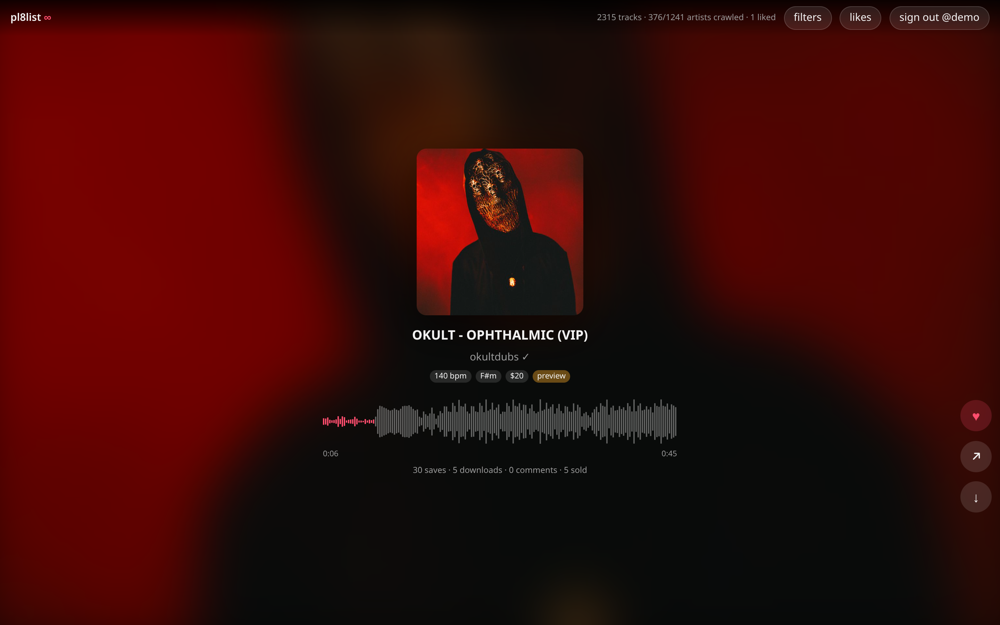
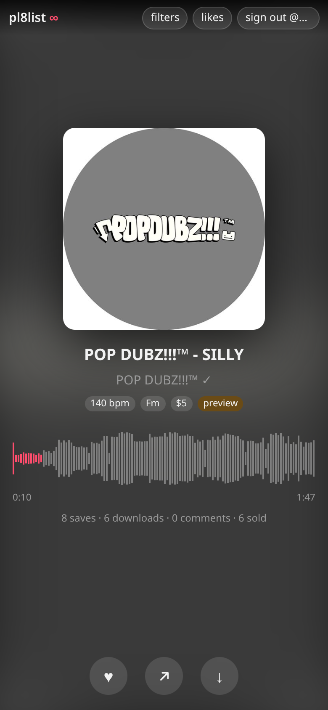
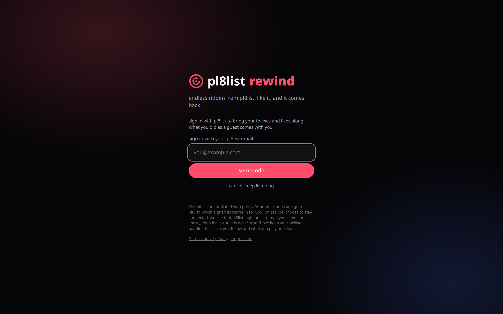
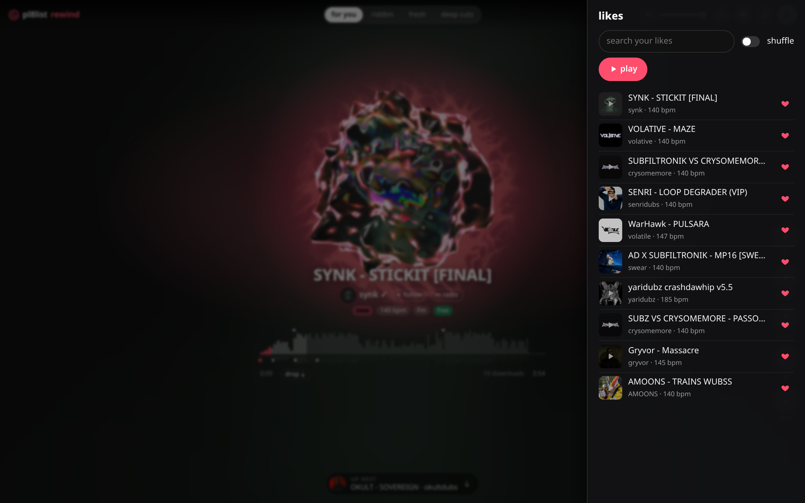
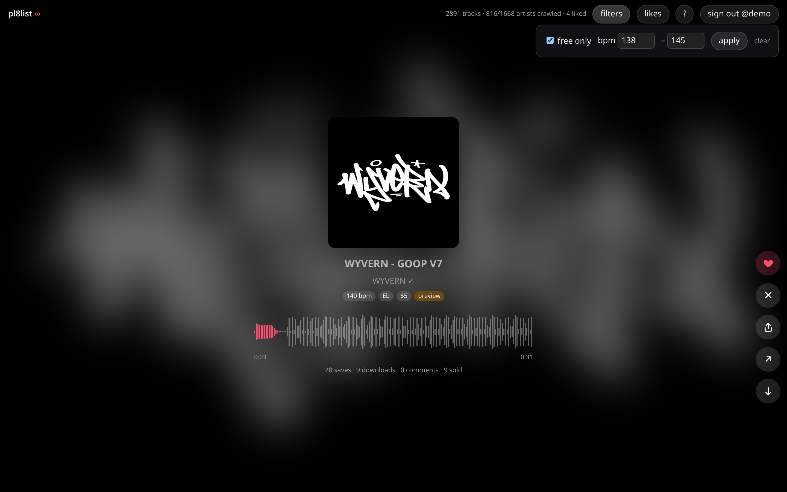

# pl8list ∞

An endless, TikTok-style scroll through [pl8list](https://pl8list.com), with its own
recommendation algorithm that learns from what you like, finish and skip. Sign in with
your pl8list account; each user gets their own feed and taste profile.

Not affiliated with pl8list.



<p align="center">
  
  
</p>

| Likes | Filters |
| ----- | ------- |
|  |  |

## Run

```sh
docker compose up -d --build       # http://127.0.0.1:8790
```

or without Docker (Rust 1.85+):

```sh
cd backend && cargo run --release   # serves ../static, embedded at build time
cargo test                          # unit tests + API tests against a fake pl8list
```

The server is the Rust crate in `backend/`. The old Python server (`server.py` and friends)
still works on the same database and is kept until the Rust one has run in production for a
while; `python3 server.py` starts it.

Before going public in Germany, set the Impressum variables below. `/impressum` and
`/datenschutz` are filled in from them at startup; the texts are in `backend/templates/`.
Have them checked: they are a careful draft, not legal advice.

`compose.override.yaml` puts it behind Traefik at `pl8.narl.io` on the external `narl`
network, the same way as the other narl.io services. Docker Compose picks it up
automatically. Delete it, or change the host name, to run somewhere else.

Data (catalogue, users, listening history) lives in the `data` volume as one SQLite file.

| variable      | default            | meaning                                           |
| ------------- | ------------------ | ------------------------------------------------- |
| `HOST`        | `127.0.0.1`        | bind address (`0.0.0.0` in the image)             |
| `PORT`        | `8790`             | port                                              |
| `PL8_DB`      | `./pl8list.db`     | SQLite path (`/data/pl8list.db` in the image)     |
| `TRUSTED_PROXY_HOPS` | `0`         | reverse proxies in front that append to `X-Forwarded-For` (`TRUST_PROXY=1` also means 1) |
| `PUBLIC_ORIGIN` | unset            | `https://host` of the site; POSTs with any other `Origin` are refused |
| `CACHE_DIR`   | `cache` next to DB | disk cache for audio segments and artist images   |
| `CACHE_MAX_MB` | `2048`            | cache size limit, least recently used files go first |
| `INSECURE_COOKIES` | `0`           | `1` only for plain-http development from another machine |
| `IMPRESSUM_NAME`, `IMPRESSUM_ADDRESS`, `IMPRESSUM_EMAIL`, `IMPRESSUM_PHONE` | empty | operator details for `/impressum` and `/datenschutz`; separate address lines with `\|` |
| `HOSTING_PROVIDER` | empty         | hosting company and address, named in the privacy policy |

## Accounts

There are no passwords here. Users sign in with the email of their pl8list account:

1. The user enters their email. The server starts pl8list's own login, and pl8list mails
   them a 6-digit code.
2. The user types the code. The server passes it to pl8list. If pl8list accepts it, the
   server reads the user's pl8list id and handle, creates a local account, and sets its
   own session cookie (`__Host-pl8inf`, Secure, HttpOnly, SameSite=Lax). It ends after 30 days
   without use and gets a new token every 7 days.

The pl8list session from step 2 is used once, in memory, to read the user's personal pl8list
feed (artists in their library). It is never written to disk, and when the feed has been
read (or reading it fails) the server logs that session out at pl8list. Only a SHA-256 hash
of the local session token is stored.

Every login start and resend makes pl8list send a mail, so they are rate-limited: 5 per IP
and 3 per email per 15 minutes, 30 per 10 minutes for the whole server, at most 2 resends
and 5 code attempts per login, and at most 500 logins pending at once. Behind a proxy
(`TRUSTED_PROXY_HOPS=1`) the client IP is the last `X-Forwarded-For` entry, the one the proxy
added; IPv6 addresses are limited per /64.

The "account" menu lets users download everything stored about them (JSON), sign out on all
devices, or delete their account (likes, history and sessions, right away). Expired sessions
are purged hourly and "served" events after 180 days. The browser only ever talks to this
server: hls.js is self-hosted in `static/vendor/` and audio and images are proxied, so no
visitor address reaches pl8list or a CDN.

## Controls

| phone            | desktop              | action                         |
| ---------------- | -------------------- | ------------------------------ |
| tap              | click · space        | play / pause                   |
| double-tap       | double-click · l     | like                           |
| swipe up / down  | ↓ j · ↑ k            | next / previous                |
| drag waveform    | drag waveform · ← →  | seek                           |
| ✕ button         | x                    | not for me (skip, show less)   |
| share button     | s                    | share / copy link              |
|                  | m                    | mute                           |
|                  | ? · Esc              | help · close panels            |

Lock-screen, notification and headphone buttons control playback too (Media Session API).
"likes" lists your likes newest first; ▶ plays one right away. Filters (free only, BPM range)
are remembered per browser. The site can be installed to the home screen as an app.

## How it works

pl8list has no public API, but it is a Remix app: every page loader returns JSON when you add
`?_data=<route id>`, and `/api/*` routes return JSON directly. Paginated loaders also need
`pagination=true`. All of this works without an account for public data:

| endpoint                                                             | gives                               |
| -------------------------------------------------------------------- | ----------------------------------- |
| `/?_data=routes/_index`                                              | best sellers, recommended, ticker   |
| `/api/feed?page=N&pagination=true`                                   | a user's feed (needs their session) |
| `/api/activity-ticker`                                               | artists with recent downloads/sales |
| `/best-selling-artists?_data=routes/best-selling-artists`            | top artists                         |
| `/search/users?q=…&page=N&pagination=true&_data=routes/search.users` | artist search (≥ 3 chars)           |
| `/<handle>?page=N&pagination=true&_data=routes/$handle`              | an artist's tracks, 10 per page     |
| `/<handle>/<slug>/related?_data=routes/$handle_.$slug.related`       | 3 related tracks                    |
| `/api/<handle>/<slug>/hls/playlist.m3u8?v=<uploadId>[&preview=true]` | HLS audio                           |
| `/login`, `/verify?email=…&mode=login`                               | email + 6-digit code login          |

**Crawler** (`backend/src/crawler.rs`). There is no "all tracks" listing, so one shared catalogue grows by
snowballing: home sections, the ticker, best-selling artists and artist search give artists;
artist pages give tracks; related pages pull in neighbours. Artists are re-checked daily for
new uploads. Requests are throttled to about 1.4 per second while someone has used the app in
the last 30 minutes, or while the catalogue has fewer than 500 tracks. Otherwise it slows to
one request every 20 seconds. When a user likes or finishes a track, its related tracks and
its artist's catalogue are crawled first.

**Ranking** (`backend/src/ranker.rs`). Each track the user has not seen yet gets a score from popularity,
freshness, artist affinity (from their likes, completions, skips and "not for me"), closeness to the BPM and
key of tracks they liked, whether it is related to something they liked, and some random
exploration. Artists are then spread out so you don't get five tracks from one person in a
row. Weights live in a `Ranker`; `?mode=` on `/local/feed` picks one, so discovery modes
can be added next to `Classic`.

**Audio.** The browser only talks to this server. HLS playlists and segments are proxied from
pl8list as a guest, so users hear previews of paid tracks and full free tracks, the same as a
logged-out visitor on pl8list. Segments and images are cached on disk, so a repeat play costs
pl8list nothing. Segment URLs carry a signed token; only tokens seen in a playlist we fetched
ourselves are used as cache keys, so a forged token can't pull another track out of the cache.
